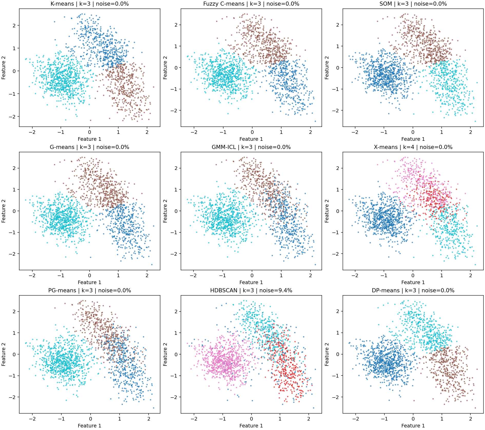
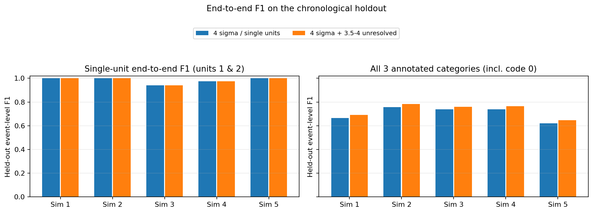
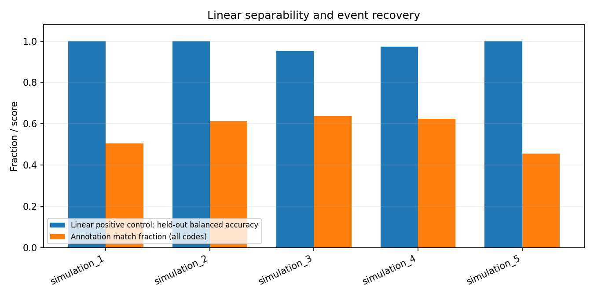

# Extracellular Spike Sorting — Detection, Clustering, and Validation

**Original academic project: 2019** · **Python-based computational validation: 2026**  
**Data provenance:** Neural Engineering Laboratory, Iran University of Science and Technology (IUST)  
**Reference execution:** `20261122T060055_422939Z` (22 November 2026)

This repository documents a comparative study of extracellular spike detection, waveform features, and clustering on five **simulated**, reference-annotated recordings. The analysis examines K-means, fuzzy C-means, a self-organizing map (SOM), G-means, GMM-ICL, X-means, PG-means, HDBSCAN, and DP-means. Several methods use explicitly documented adaptations; the reported implementations should not be conflated with their canonical definitions.

The original work dates to **2019**. The current Python notebook, complete reference execution, numerical checks, and documentation were produced or revised in **2026**. The original course report does not independently date every method added to the later nine-method benchmark.

## Reference results

| Quantity | Value | Interpretation |
|---|---:|---|
| Recordings × clustering methods | 5 × 9 = **45** | Primary configurations, not independent animals |
| GMM-ICL mean ARI, all annotation codes | **0.9624** | Matched detected events, averaged across five recordings |
| GMM-ICL mean ARI, nonzero codes | **0.9728** | Matched detected events from codes 1 and 2 |
| Held-out event-level micro-F1, codes 1–2 | **0.9738** | Primary 4σ detector; not overall event performance |
| Held-out event-level micro-F1, codes 0/1/2 | **0.7131** | Primary 4σ detector; missed events included |

The event-level results use a chronological 70/30 train/test split **within each previously examined simulation**, not an external biological test cohort. The reference matching convention and training-only cluster-to-label relabeling are described in `Results/END_TO_END_PROTOCOL.json`. In particular, the 97.38% F1 for codes 1–2 must **not** be reported as an overall three-code performance figure.

*Simulation 3 is an important challenging case; its performance is lower for several methods than for the easiest simulations. Results from all five are retained.*

### Additional visual comparisons

*End-to-end held-out F1 is shown separately for codes 1–2 and for all three annotation categories. The two panels have different evaluation scopes.*

*Three wavelet feature representations are compared using matched-event ARI and model-order stability across the five simulations.*

*The linear-separability positive control is compared with annotation match fractions, distinguishing cluster separability from event recovery.*

## Validated reference execution

A complete `FULL_VALIDATION=True` run on **22 November 2026** produced the archive `SpikeSorting_2019_v3_20261122T060055_422939Z_Results.zip` (48,319,586 bytes).

- SHA-256: `57166309bf7c8c3a16032361cebb4a3af0ba3d1ac98da98ba89c6e31edd6822a`
- Python **3.13.18**; NumPy **2.4.6**; SciPy **1.16.3**; pandas **2.2.3**; scikit-learn **1.6.1**.
- `FULL_VALIDATION_STATUS.json` and five per-recording `COMPLETE.json` checkpoints indicate completed validation. The archive contains **45** ten-seed method/recording stability records, **270** threshold/PCA-sensitivity records, **70** method-parameter records, and polarity, onset-alignment, and permutation controls.
- The archive contains **92** generated figures; eight selected figures and lightweight tables are tracked in this repository.
- All 45 primary configurations have the **same scientific values** as the earlier archived run. Their measured `fit_s` timings differ, as expected across executions.

Reference tables, input-file checksums, and completion manifests are provided so readers can inspect the archived execution and reproduce the reported analysis.

An earlier **scikit-learn 1.8.0** rerun agreed exactly on 43/45 primary ARI rows and differed slightly for HDBSCAN in simulations 3 and 5. The reference-environment execution uses **1.6.1** and reports the full validation as complete. Preserve this dependency qualification when making cross-version comparisons.

## Files and download locations

- `Notebooks/01- Spike Sorting 2019 v3 - Final Figures and Validation.ipynb` — complete analysis notebook with its saved figures and numerical results.
- `Results/` — CSV tables and key machine-readable manifests.
- `Figures/` — eight selected figures. The complete figure gallery and checkpoint files remain in the full ZIP archive.
- `Data/SHA256SUMS.txt` — checksums for the five source MAT files; data are distributed separately from Git history.
- `Docs/VALIDATION_2026-11-22.md` — details of the reference execution, checks, and interpretation.
- `Scripts/verify_release_artifacts.py` — offline integrity checks for the results ZIP and optional raw MAT data archive.

**Release assets (publish separately through GitHub Releases):**

1. `SpikeSorting_2019_v3_20261122T060055_422939Z_Results.zip` — complete reference-run outputs (48.3 MB decimal).
2. `Spike_Sorting_2019_Five_MAT_Data.zip` — optional raw-input bundle (approximately 112 MB decimal), subject to the author's stated publication permission and any upstream attribution requirements.

*These assets are prepared but not uploaded to GitHub Releases until the repository and release are created.*

## Running the notebook

1. Use **Google Colab**, preferably Python 3.13.18 for closest replay. Before running the notebook, install recorded core dependencies with `pip install -r requirements.txt` and **restart the runtime** if package versions change. Exact versions of ancillary display packages were not recorded, so this is a core dependency specification rather than a complete environment lockfile.
2. Place `simulation_1.mat` through `simulation_5.mat` in `MyDrive/Computational Neuroscience/`, or edit `DATA_DIR_OVERRIDE` near the top of the notebook.
3. Leave `DATASETS=(1,2,3,4,5)` and `FULL_VALIDATION=True` for the complete run. Set `FULL_VALIDATION=False` only for a shorter diagnostic run.
4. Each run receives a unique stamp. Read `FULL_VALIDATION_STATUS.json` and `RUN_COMPLETENESS_MANIFEST.json` before reporting completion. The notebook's inline execution counters alone are not proof of completion, because some saved counters are empty.
5. Verify the archived result files: `python Scripts/verify_release_artifacts.py --results-zip <path-to-results-zip> [--data-zip <path-to-mat-zip>]`.

## Limitations and responsible interpretation

- The simulation files contain reference annotation codes `0`, `1`, and `2`; the MAT files do not independently establish three isolated biological neurons or the identity of code `0`. External simulator documentation would be needed to settle those biological interpretations.
- `samplingInterval` is interpreted in milliseconds for analysis; original acquisition/simulation documentation should be consulted before presenting the temporal unit as externally verified.
- The label alignment for evaluation uses **training reference annotations**, while clustering/model selection does not use those labels. Thus the method is not evaluated as a fully label-free end-to-end identity-assignment system.
- The 70/30 split protects temporal holdout **within the same simulations**; parameter and feature comparisons on these five recordings are exploratory, not independent replication or a claim of clinical validity.
- Selected model-order and clustering procedures are adapted variants and should be cited by their actual implemented rules.
- Results are a numerical comparison on simulations, **not validation of biological single-unit isolation** or evidence of generalization to human/animal recordings.

**Code license:** MIT (see [LICENSE](LICENSE)) for author-owned software and associated documentation. Laboratory-provided datasets and third-party material retain their respective usage terms; the MIT license does not grant rights to those external materials.

**Research identifier:** [Sam Ghanbarzadeh — ORCID 0000-0003-4040-1098](https://orcid.org/0000-0003-4040-1098).
